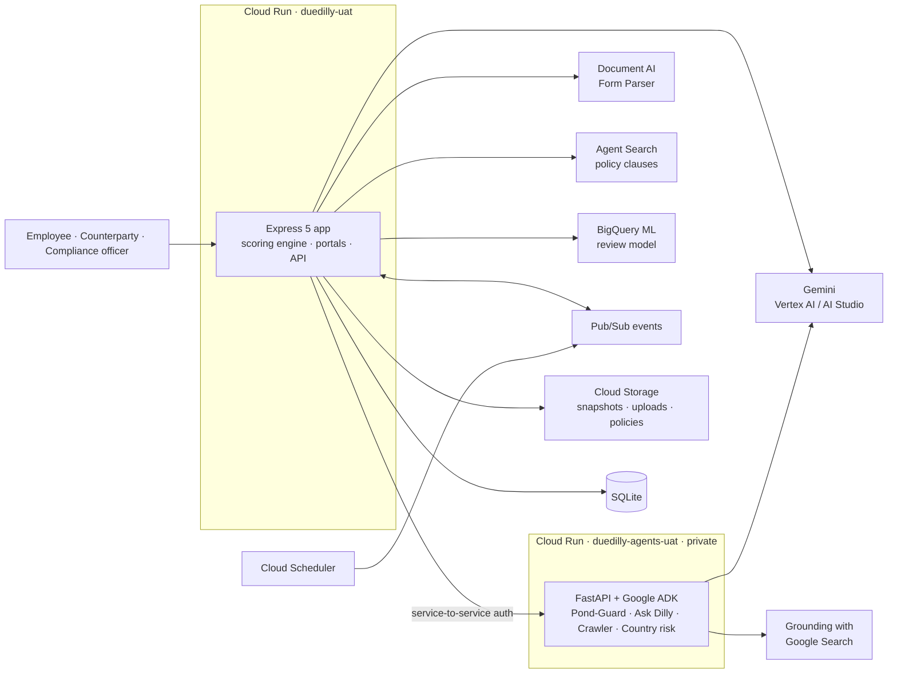

<p align="center">
  
</p>

<h1 align="center">DueDilly</h1>

<p align="center">
  <b>AI agents that screen your counterparties, show their working, and let a person decide.</b><br>
  <i>Get your ducks in a row.</i>
</p>

<p align="center">
  🎥 <a href="https://www.youtube.com/watch?v=DqFB6EApUzc"><b>Demo video</b></a> &nbsp;·&nbsp;
  📊 <a href="https://canva.link/63vpgrq2a18vbds"><b>Pitch deck</b></a> &nbsp;·&nbsp;
  🌐 <a href="https://duedilly-uat-gqthvx5oha-as.a.run.app"><b>Live demo</b></a>
</p>

<p align="center">
  
  
  
  
  
</p>

---

## The problem

Banks, insurers, traders and shippers must know who they are dealing with before they pay, insure or
contract them. That third-party risk and KYC work is still mostly manual: analysts search sanctions lists,
PEP databases, news and registries by hand, chase questionnaires by email, and write up decisions in
spreadsheets.

It is **slow** (onboarding waits on an analyst), **inconsistent** (two analysts, two answers) and
**hard to audit** (the reasoning lives in someone's head). Black-box AI scoring makes the last part worse:
a regulator will not accept "the model said 85".

## What DueDilly does

DueDilly screens **organisations, people and vessels** against sanctions, PEP, adverse media, ownership,
country and vessel-behaviour risk, keeps monitoring them, and runs the due diligence questionnaire (DDQ)
with the counterparty, end to end.

Its core rule:

> **The AI understands. The rules score. A person decides.**

- **Gemini agents read** the sources and return *findings*: structured facts, each with an exact quote,
  a source link and the time it was read.
- **A deterministic points table scores** those findings. The AI never picks the number or the route.
- **Confidence is computed** from evidence quality, separately from risk.
- **A compliance officer signs** every decision, with an AI draft they must edit or confirm.

Every point on screen traces to one finding, one rule, one policy clause and one source.

---

## See it in 60 seconds: the Aurora Venture case

1. The crude tanker **Aurora Venture** goes dark for 31 hours, then does a ship-to-ship transfer. A **Ripple** alert fires.
2. **Pond-Guard** launches five ADK agents in parallel. The drawer shows each one working live, then its sourced findings.
3. The **"Why 85?"** panel adds it up:

   | Finding | Rule | Points |
   | --- | --- | --- |
   | AIS dark 31 hours | Vessel AIS dark > 24 h in 90 days (§5.4) | +20 |
   | Ship-to-ship transfer | STS transfer in a high-risk area (§5.4) | +20 |
   | Flag changed twice since 2024 | 2+ flag changes in 3 years (§5.4) | +10 |
   | Cameroon flag | Country CPI below 40 (§4.1) | +20 |
   | Nominee owner | Ownership unclear (§1.3) | +15 |
   | **Total** | | **85 · High** |

4. Confidence is weighed from source trust, match strength and freshness. The route is computed: **Escalate**.
5. The **reviewer copilot** drafts a decision that cites the finding IDs and policy clauses. The officer edits and signs.
6. The ship manager answers the DDQ. **Duck-Scanner** reads the returned PDF; **answer verification** flags
   any answer that contradicts the evidence, quoting both sides.

This exact case is a unit test (`tests/risk.test.js`): Aurora Venture scores 85 from its findings.

---

## Key features

| | Feature | What it does |
| --- | --- | --- |
| 🛡️ | **Pond-Guard agents** | ADK `ParallelAgent` runs sanctions, PEP, adverse media, ownership and vessel agents at once. Adverse media uses **Grounding with Google Search**; sanctions and PEP use the app's own lists, not the open web. A `dilly` coordinator agent writes the summary. |
| 🧮 | **"Why &lt;score&gt;?" panel** | One row per counted finding: points, rule, policy clause, quote and source link. Then total, level, confidence parts and route. |
| 🪜 | **6-step pipeline strip** | Read → Understand → Check → Score → Weigh → Route, shown on every case. |
| 💬 | **Ask Dilly** | ADK agent with read-only tools (search counterparties, get a case, list alerts, get a risk breakdown). Paste a link and it reads it with the **URL context** tool. It never changes data. |
| 🕸️ | **Source crawler agents** | One agent per website source. Checks `robots.txt`, never reads behind a login, snapshots the page, extracts entities with Gemini, and publishes `source-changed` when something changes. |
| 🩹 | **Self-healing extraction** | When a source breaks (layout change, zero records), the agent proposes new extraction instructions with a test result. A person approves; nothing is applied automatically. |
| 🌊 | **Ripples triage** | Gemini sets severity, merges duplicates and writes a one-line "what changed". High severity triggers a re-screen. |
| 📜 | **Policy search** | **Agent Search** indexes one file per policy clause. Every route shows the clause it relied on. |
| ✍️ | **Reviewer copilot** | Drafts the case summary and decision reason with checked citations. Labelled "AI draft"; both draft and final are stored. |
| 🦆 | **Duck-Scanner** | **Document AI Form Parser** reads a returned DDQ PDF; Gemini maps fields to question numbers with a confidence per field. Low-confidence fields are flagged for the supplier. |
| 🔍 | **Answer verification** | Compares DDQ answers with findings (e.g. "No PEP" vs a PEP finding) and shows each contradiction with both quotes. |
| 📈 | **Dilly learns** | **BigQuery ML** boosted-tree model trained on reviewer decisions predicts which cases an officer is likely to mark red, with reasons from `ML.EXPLAIN_PREDICT`. Suggestions only; it never changes a score or route. Trained on labelled synthetic reviews for the demo. |
| 🌍 | **Globe** | Watchlist on an interactive globe (D3 orthographic): CPI 2025 country fill, FATF / OFAC / EU sanctions views (read by an ADK `country_risk` agent), vessel positions and routes, ownership arcs. |
| 🚢 | **Vessel IMO check** | Every IMO is checked on VesselFinder; a name, flag or type mismatch becomes a finding. |
| 🧑‍💼 | **Three portals** | Employee intake (with AI auto-fill from a document), counterparty DDQ portal (one-time signed link that locks after submit), compliance workspace. Google sign-in, plus demo personas. |

---

## How the AI works

### Findings, not verdicts

Gemini returns findings through **structured output with a response schema**, validated before saving
(`src/risk/findingSchema.js`): `category, subject, summary, evidence_quote (≤300 chars), source_url,
source_trust, read_at, match_basis, corroborating_sources[], agent, model_id, prompt_version`.

**No source, no points.** A finding without a `source_url` is rejected and stored with the reason, so it can be audited.

### Points table → risk level

One config file, `src/risk/points.config.js`, drives the scorer, the "Why" panel and the Reviews editor.
Each row counts once per case; the total caps at 100. Compliance officers can tune the numbers in
**Reviews › Scoring rules**.

| Finding | Points | Finding | Points |
| --- | --- | --- | --- |
| Confirmed sanctions match (name + 2nd identifier) | **= 100, always Escalate** | Ownership unclear | +15 |
| Possible sanctions match (strong name only) | +40 | Broker or intermediary | +10 |
| PEP director, shareholder or owner | +25 | Vessel AIS dark > 24 h | +20 |
| PEP family or close associate | +15 | Vessel ship-to-ship transfer | +20 |
| Country CPI below 40 | +20 | Vessel 2+ flag changes in 3 yrs | +10 |
| Country CPI 40–59 | +10 | Contract above SGD 100,000 | +5 (and sends a DDQ) |
| Severe adverse media (24 months) | +25 | DDQ answer contradicts evidence | +15 |
| Other adverse media (24 months) | +10 | DDQ not returned after 14 days | +10 |

**Low** 0–49 🟢 · **Medium** 50–74 🟠 · **High** 75–100 🔴

### Confidence

Per finding: **source trust × match strength × freshness**, +0.15 for a second independent source.
Case confidence is the points-weighted average. With no findings, confidence is **coverage**: the share
of required checks that actually ran. A clean result is only "high confidence" if the checks ran.

### Routes

| | Confidence < 80% | Confidence ≥ 80% |
| --- | --- | --- |
| **Risk 50–100** | Investigate | Escalate |
| **Risk 0–49** | Fill the gaps | Auto-clear |

### Guardrails

- The AI never sets the risk number or the route.
- A confirmed sanctions match is always Escalate. Embedding or name similarity alone never confirms one.
- A person signs every decision.
- Crawlers respect `robots.txt` and never read behind a login.
- Every AI endpoint has a per-IP rate limit and a daily cap (`AI_RATE_LIMIT_MAX`, `*_DAILY_CAP`).
- Every cloud service has a labelled offline fallback, and the full test suite runs offline with Gemini disabled.

---

## Architecture



- **The app** (Node.js, Express 5) owns the data, the deterministic scorer and the UI. It calls Gemini
  through one shared client that works with an **AI Studio key** or **Vertex AI**, with a model fallback chain.
- **The agents service** (Python, FastAPI, Pydantic, Google GenAI SDK, **google-adk 2.11.0**) hosts every ADK
  agent. It is a private Cloud Run service; the app calls it with service-to-service authentication.
- **Events** (`screening-requested`, `screening-completed`, `ddq-submitted`, `alert-raised`, `rescreen-due`,
  `source-changed`) flow through Pub/Sub; Cloud Scheduler drives crawls and daily re-screens.
- **Every service has a fallback**: no key → labelled offline samples; no Pub/Sub → in-process events;
  no Agent Search → local policy text; no Document AI → Gemini reads the PDF directly.

---

## Google technologies used

| Technology | Used for | Where |
| --- | --- | --- |
| **Google ADK** | Pond-Guard (`ParallelAgent`, `SequentialAgent`), Ask Dilly, crawler, self-healing, country risk | `agents/app/` |
| **Gemini on Vertex AI** | All agents and AI features on Cloud Run | `src/services/geminiClient.js`, `agents/app/settings.py` |
| **Google AI Studio** | Gemini API key for development and prompt prototyping, same client | `src/services/geminiClient.js` |
| **Grounding with Google Search** | Adverse media agent | `agents/app/pond_guard.py` |
| **URL context tool** | Ask Dilly reads pasted links | `agents/app/ask_dilly.py` |
| **Cloud Run** | The app and the agents service | `Dockerfile`, `agents/Dockerfile`, `scripts/deploy.sh` |
| **BigQuery ML** | Boosted-tree review model, `ML.EXPLAIN_PREDICT` | `src/learning/bqModel.js` |
| **Agent Search** (Vertex AI Search) | Policy clause search | `src/services/policySearch.js`, `scripts/agent-search-setup.sh` |
| **Document AI** (Form Parser) | Duck-Scanner | `src/services/duckScannerService.js` |
| **Pub/Sub** | Event bus | `src/events/bus.js`, `scripts/pubsub-subscriptions.sh` |
| **Cloud Scheduler** | Crawls and daily re-screens | `scripts/gcp-setup.sh` |
| **Cloud Storage** | Page snapshots, DDQ uploads, policy files | `src/services/objectStorage.js` |
| **Secret Manager** | Keys and tokens for Cloud Run | `scripts/deploy.sh` |
| **Google sign-in** | Staff sign-in | `src/routes/auth.js` |
| **Google Maps Places** | Address autocomplete on intake | `src/routes/places.js` |

---

## Tech stack

- **Backend:** Node.js 24 · Express 5 · SQLite (`node:sqlite`) · JWT sessions
- **Agents:** Python · FastAPI · Pydantic · Google GenAI SDK · Google ADK 2.11.0
- **Frontend:** HTML, CSS and vanilla JavaScript · D3 globe · Dilly SVG mascot and motion
- **Cloud:** Cloud Run · Vertex AI · BigQuery · Agent Search · Document AI · Pub/Sub · Cloud Scheduler · Cloud Storage · Secret Manager
- **Tests:** `node --test` (270) · Python `unittest` (15), all offline

---

## Getting started

### Prerequisites

- Node.js 24+
- Python with `google-adk==2.11.0` (for the agents service; see `agents/requirements.txt`)
- Docker (for the UAT port and Cloud Run images)
- `gcloud` CLI (only to deploy)

### Run locally

```bash
npm install
npm test               # 270 tests, offline, Gemini disabled
npm run test:agents    # 15 agents-service tests
npm run dev            # http://localhost:8080  (offline-friendly, settings from .env.dev)
npm run agents         # ADK agents service on http://localhost:8090
npm run uat            # http://localhost:8081  (local copy of the production image, settings from .env.uat)
npm run live           # open the deployed live demo on Cloud Run, after a health check
```

Copy `.env.example` to `.env.dev` or `.env.uat` first. **The app starts with every variable commented out**
and runs on labelled offline fallbacks. Open http://localhost:8080/login and pick a demo account.

```bash
npm run demo:reset     # load the scripted demo story (Aurora Venture, Halcyon Marine Services, ...)
npm run demo:clean     # empty workspace for your own tests
```

### Environment variables (names only; see `.env.example`)

| Group | Variables |
| --- | --- |
| Core | `APP_ENV`, `PORT`, `DATABASE_PATH`, `JWT_SECRET`, `DEMO_MODE`, `WORKSPACE_NAME`, `CORS_ORIGIN` |
| Gemini | `GEMINI_BACKEND`, `GEMINI_API_KEY`, `GEMINI_MODEL`, `GEMINI_FALLBACK_MODELS`, `VERTEX_GEMINI_MODEL`, `VERTEX_GEMINI_FALLBACK_MODELS` |
| Google Cloud | `GOOGLE_CLOUD_PROJECT`, `GOOGLE_CLOUD_LOCATION`, `GOOGLE_GENAI_USE_VERTEXAI` |
| Agents service | `AGENTS_SERVICE_URL`, `AGENTS_MODEL`, `AGENTS_THINKING_LEVEL`, `AGENTS_INTERNAL_TOKEN`, `AGENT_RUNTIME` |
| Agent Search | `AGENT_SEARCH_DATA_STORE`, `AGENT_SEARCH_LOCATION` |
| Document AI | `DOCUMENT_AI_PROJECT_ID`, `DOCUMENT_AI_LOCATION`, `DOCUMENT_AI_PROCESSOR_ID` |
| BigQuery | `BIGQUERY`, `BIGQUERY_DATASET`, `BIGQUERY_LOCATION`, `BIGQUERY_MAX_BYTES_BILLED`, `ML_TUNING_TRIALS` |
| Events and storage | `PUBSUB_MODE`, `PUBSUB_EMULATOR_HOST`, `PUBSUB_PUSH_AUDIENCE`, `PUBSUB_PUSH_SERVICE_ACCOUNT`, `GCS_BUCKET`, `DOCUMENT_STORAGE` |
| Sign-in | `GOOGLE_CLIENT_ID`, `COMPLIANCE_OFFICER_EMAILS` |
| Data sources | `VESSELFINDER_API_KEY`, `VESSELFINDER_LOOKUP`, `GOOGLE_MAPS_API_KEY`, `COUNTRY_RISK_FETCH` |
| Limits | `AI_RATE_LIMIT_MAX`, `AI_RATE_LIMIT_WINDOW_MINUTES`, `CONFIDENCE_THRESHOLD`, `POND_GUARD_DAILY_CAP`, `COPILOT_DAILY_CAP`, `TRIAGE_DAILY_CAP`, `CRAWLER_DAILY_CAP`, `DOCUMENT_AI_DAILY_CAP`, `AGENT_SEARCH_DAILY_CAP`, `COUNTRY_RISK_DAILY_CAP`, `ML_TRAIN_DAILY_CAP` |

### Try it with the test documents

All companies and people are fictional. Files are in [`docs/test-docs/`](docs/test-docs/); each starts with a
comment saying how to use it and what to expect.

| Step | File | Where |
| --- | --- | --- |
| 1. Upload a policy | `policy-guideline-mock.md` or `kyc_policy.pdf` | Policies › Upload policy |
| 2. Submit a company | `pelican-quay-intake.pdf` | Employee portal › New request › Auto-fill from document |
| 3. Submit a vessel | `02-intake-vessel.md` (green, orange and red cases) | Same, one PDF per case |
| 4. Answer the DDQ | `pelican-quay-ddq.pdf` or `ddq-organisation-red.md` | Counterparty DDQ link › Prefill from a document |
| 5. Review | — | Compliance › open the case › Approve, Bounce back to counterparty, or Reject |

Vessel IMO numbers are checked on VesselFinder, so step 3 needs internet access.

### Deploy to Cloud Run

Follow **[DEPLOY_GUIDE.md](DEPLOY_GUIDE.md)** step by step. It shows where every key comes from.

```bash
bash scripts/gcp-setup.sh          # once: service account, secrets, bucket, topics, schedules
bash scripts/deploy.sh uat         # the app
bash scripts/deploy.sh agents-uat  # the ADK agents service
bash scripts/deploy.sh uat         # again, so the app learns the agents' address
bash scripts/smoke.sh <your link>
```

Region: `asia-southeast1`. The app runs as a single instance (SQLite on the instance disk; data resets on restart, and the UI says so).

---

## Project structure

```text
.
├── src/
│   ├── server.js            Express app and page routes
│   ├── risk/                points.config.js, scorer, findings schema, rules store
│   ├── agents/              in-process agent runtime and orchestrator (offline fallback)
│   ├── services/            Gemini client, Pond-Guard, copilot, Duck-Scanner, crawler, policy search, ...
│   ├── learning/            review model (BigQuery ML and offline boosted trees)
│   ├── countryRisk/         FATF / OFAC / EU views
│   ├── events/              Pub/Sub bus and handlers
│   ├── accounts/            workspaces, accounts, sign-in
│   ├── routes/              REST API
│   └── db/                  SQLite and seed data
├── agents/                  Python ADK agents service (FastAPI) + its Dockerfile and tests
├── *.html, *.js, *.css      employee, compliance and DDQ portals; Dilly loader and motion
├── assets/                  Dilly mascot, ducklings, DDQ icons (SVG)
├── docs/policies/           policy clauses indexed by Agent Search
├── docs/test-docs/          fictional test documents
├── scripts/                 setup, deploy, smoke test, demo reset
├── tests/                   node --test suites
├── Dockerfile               Cloud Run image for the app
├── cloudbuild.yaml          Cloud Build pipeline
└── DEPLOY_GUIDE.md          keys and deployment, step by step
```

---

## Roadmap

Not built yet:

- **Quack-Back**: an ADK chat agent that walks the supplier through the DDQ section by section
- **Automatic DDQ email** through the Gmail API (today the officer copies the one-time link)
- **Pond forecast**: 90-day risk outlook per country and sea lane with BigQuery `AI.FORECAST`
- **Smarter name matching** with embeddings and `VECTOR_SEARCH`
- **AIS anomaly checks** with BigQuery `AI.DETECT_ANOMALIES`
- **"How Dilly works"** page listing every Google service with its live status

---

## Team

- **Hudzaifah**
- **Tan Jun Hern**

Built with **Google Antigravity** and **Google AI Studio**. [OTHER AI TOOLS — TO ADD]

All counterparties, people, vessels and events in the demo data are fictional, except two real IMO numbers
used only so the VesselFinder check passes.
